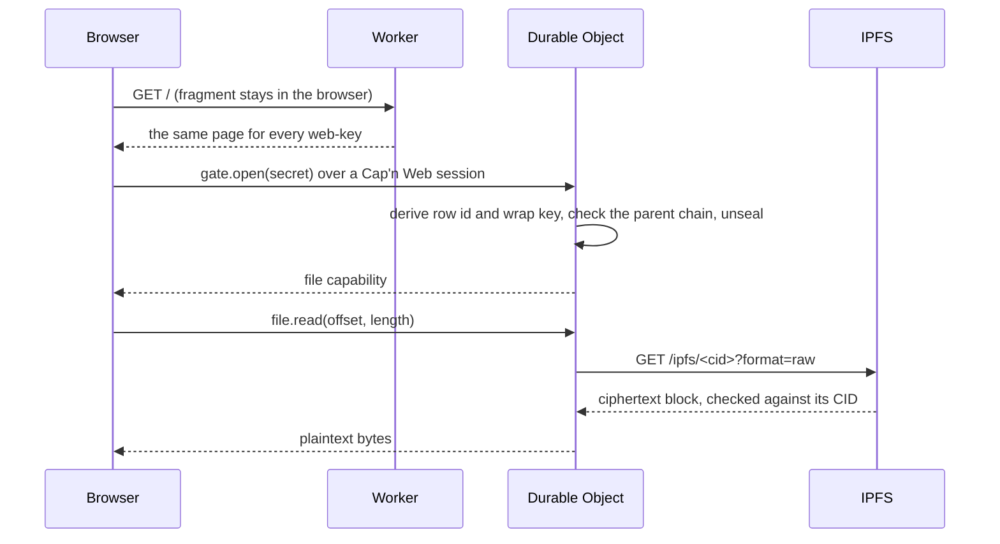

# cf-webkey-ipfs

Read access to files on IPFS, controlled by object capabilities and handed
out as [web-keys](https://waterken.sourceforge.net/web-key/). A Cloudflare
Worker is the gateway; clients talk to it over
[Cap'n Web](https://github.com/cloudflare/capnweb).

A prototype for local exploration. Do not deploy it as is; see
[Limits](#limits).

## The idea, and where it lives

| Idea                                   | Here                                                                                                                          |
| -------------------------------------- | ----------------------------------------------------------------------------------------------------------------------------- |
| Access is a web-key                    | `https://host/#<kind>:<secret>`. `public/app.js` reads the fragment and sends the secret inside the RPC session.              |
| A table of capabilities and secrets    | `src/refTable.js`, stored by `src/sqlRowStore.js` in the Durable Object's SQLite.                                             |
| The table at rest grants nothing       | `src/secrets.js`: a row is keyed by `HKDF(secret, "row id")` and its payload sealed under `HKDF(secret, "wrap key")`.         |
| Capabilities are shared like Cap'n Web | `src/caps.js`: `gate.open(secret)` returns a live `vault` or `file`; their methods return further capabilities.               |
| Data lives on a p2p network            | `src/files.js` splits a file into chunks, `src/cipher.js` encrypts each with a per-file key, `src/ipfsBlocks.js` stores them. |
| The network is not trusted             | Only ciphertext is published, and every block read back is checked against its CID.                                           |
| Giving someone less than you have      | `file.share({ ttlMs })` mints a new row whose parent is the sharer's row.                                                     |
| Taking access back                     | `file.revoke(shareId)`. Every call re-checks the whole parent chain, so revocation also stops sessions already open.          |
| Mostly read                            | Only a `vault` capability can `put` or `remove`. A `file` capability can `stat`, `read`, and share onward.                    |



## Run it

Needs Node 22. The Kubo binary comes from the `kubo` npm package and its
repo is `.ipfs/` in this directory.

```sh
yarn install          # at the repo root
cd packages/cf-webkey-ipfs
yarn dev:all        # Kubo on 5781 (API) and 8781 (gateway), Worker on 8797
```

Open <http://127.0.0.1:8797>, create a vault, add a file, share it, and open
the share link in another window. Revoke it and reload that window.

With both running, `yarn e2e` drives the same flow from Node and checks
that no block in the local Kubo node contains plaintext.

`yarn ipfs` starts Kubo offline, so blocks stay on this machine. Pass
`--online` to join the public IPFS network.

```sh
yarn check          # eslint, tsc, and the specs
```

The specs run inside the Workers runtime. Outbound fetches from the Worker
land on an in-memory Kubo (`test/fakeKubo.js`), so they need no daemon.

## The capabilities

`gate` is the root of every session and carries no authority over any file:

- `createVault()` → `{ webkey }`, shown once.
- `open(secret)` → `{ kind: 'vault', vault }` or `{ kind: 'file', file }`.

`vault`: `list()`, `put(name, bytes, type)`, `get(name)` → `file`,
`remove(name)`.

`file`: `stat()`, `read(offset, length)`, `share({ ttlMs })` →
`{ webkey, shareId, expiresAt }`, `shares()`, `revoke(shareId)`.

A capability can revoke only the shares it made itself. Revoking a share
revokes everything shared onward from it.

## Limits

- The Durable Object sees secrets and plaintext in memory while it serves a
  request.
- A web-key secret is shown once. Losing a vault's web-key loses the vault.
- Anyone can create a vault; nothing meters storage.
- `put` takes a whole file in one call, at most 16 MiB.
- Removing a file does not unpin its blocks.
- The Worker writes through a Kubo RPC API. A deployed Worker would need a
  pinning service in its place.
- `harden` here is the `@endo/harden` ponyfill; the Worker does not run
  `lockdown()`.
